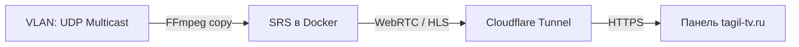

# AndroiT | SRE & Media Infrastructure Engineer
Привет! Я **AndroiT**. Специализируюсь на проектировании отказоустойчивых ИТ-инфраструктур, автоматизации CI/CD и высоконагруженных медиа-конвейерах. Разрабатываю экосистему **MediaHard** и обеспечиваю стабильность вещания распределенных программных комплексов.

## 🛠️ Технологический стек и Экспертиза
*   **Виртуализация и СХД:** Кластеры Proxmox VE (кворум, Corosync, CFS), Ceph (Monitors, OSD), ZFS, репликация через `pvesr`.
*   **Сети и Безопасность:** Bond, VLAN, MTU 9000, тонкая диагностика через `ping -M do`, `mtr`, `ss -tlnp`, SSH-туннелирование, Cloudflare Tunnels.
*   **Методология Docs as Code:** Полное документирование инфраструктуры в Markdown, сборка через **MkDocs + Material / Pandoc**, версионирование в Git.

---

## 🎬 Реализованные проекты в Продакшене

### 1. АПК «МедиаКонтур-Тагил» (Транспортный вещательный слой на tagil-tv.ru)
Автоматизированный комплекс круглосуточного вещания и оперативного удаленного мониторинга регионального пула СМИ. Развёрнут в отказоустойчивом кластере Proxmox VE с третьим арбитром QDevice (`corosync-qnetd`) на Hyper-V для защиты от split-brain.
*   **Захват (Ingest):** Изолированный низкоуровневый перехват сырых MPEG-TS (UDP Multicast) потоков из медиа-VLAN телерадиокомпании силами фоновых Docker-контейнеров FFmpeg без транскодирования видео (`-c:v copy`), что снижает нагрузку на CPU до 1-2%:
    *   *ТВ-1 (Продвижение + Тагил-ТВ)
    *   *ТВ-2 (Чистые врезки Тагил-ТВ для ОблТВ)
    *   *Радио Тагила (Врезки в Радио России):* Стриминг аудио-тракта с транскодированием в веб-стандарт `libfdk_aac` на лету.
*   **Раздача (Egress):** Проксирование потоков в медиасервер SRS (Simple Realtime Server) и выдача в браузерную панель по протоколу **WebRTC** с ультра-низкой задержкой (< 1 секунды) и резервным HLS.



### 2. Распределенный ИИ-конвейер (Генеративное ядро на mediahard.ru)
Автоматизированный многоконтейнерный ИИ-контур для генерации видеопрезентаций по ТЗ заказчика:
1.  **Детекция:** Поиск лиц по биометрическим векторам (`Buffalo_L / InsightFace`) и распознавание объектов через `YOLOv8-n`.
2.  **Сценарий:** Посекундный таймлайн и синтез текста диктора через LLM `Gemma2:9b-it` внутри Ollama.
3.  **Визуализация:** Индексация сцен в векторной базе `Qdrant` через модель `CLIP ViT-B/32` и генерация кадров через `SDXL Turbo`.
4.  **Аудио:** Синтез речи на C++ через `Piper TTS` (без PyTorch-оверхеда) и генерация фоновой музыки через `MusicGen-Small`.
5.  **Монтаж и Экспорт:** Сборка клипа через `MoviePy/FFmpeg`, рендеринг в `.mp4` (`libx264 ultrafast`) и буферизированная отгрузка в Symfony 7.

---

## 📚 Структура проекта (Documentation as Code)
Вся конфигурация инфраструктуры сопровождается Runbooks в Git-репозитории проекта `broadcast-monitor/`:
```text
├── compose.yaml            # Оркестрация SRS, Cloudflare Tunnel и FFmpeg-захватчиков
├── config/srs.conf         # Конфигурация медиасервера SRS (WebRTC/HLS)
├── web/index.html          # Лаконичный фронтенд мониторинга на базе Clappr плеера
├── docs/                   # Интерактивный онлайн-мануал (Архитектура, Инсталляция, Сеть)
└── docs-offline/
    └── manual.pdf          # Офлайн-версия, автоматически собираемая через Pandoc/CI-CD
```

## 🧪 Примеры решаемых и документируемых задач в Wiki
*   Аварийное пересоздание кластера PVE: удаление `corosync.conf`, очистка кэша CFS, перегенерация крипто-ключей.
*   Восстановление кворума Ceph и диагностика OSD (`ceph -s`).
*   Тонкая настройка сетевых интерфейсов, агрегации (bond) и валидация MTU 9000.
*   Диагностика и устранение Audio/Video desync в потоках вещания методами выравнивания GOP в FFmpeg.

## 📩 Контакты для коммерческих запросов
*   **Secure E-mail:** universwebsite@proton.me
*   **Репозиторий проекта:** GitHub Monorepo [mediahard-app](https://github.com/universwebsite/mediahard-app/blob/master/wiki/ops/docs/index.md)
*   **Проекты в продакшене:** [mediahard.ru](https://mediahard.ru) | [tagil-tv.ru](https://tagil-tv.ru)
